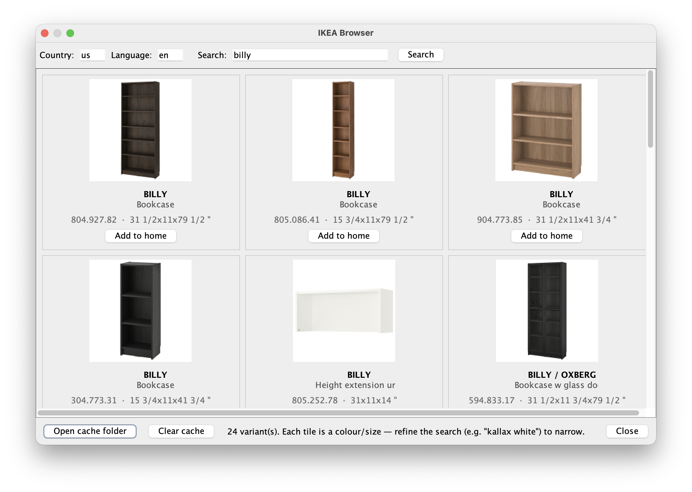

# Sweet Home 3D — IKEA Browser Plugin

A Sweet Home 3D plugin that searches IKEA's online catalog and adds the 3D
models directly into your home. Inspired by the
[`ikea-browser`](https://github.com/shish/blender-ikea-browser) Blender add-on.



## Features

- Adds **Furniture → Import IKEA model…** to Sweet Home 3D.
- In-app search of IKEA's catalog with thumbnail grid.
- Country / language are configurable (defaults to `us` / `en`).
- Decodes Draco-compressed glTF (`KHR_draco_mesh_compression`) via a
  bundled libdraco JNI library — most IKEA models use Draco.
- Per-item caching: thumbnails, downloaded GLBs, and the converted OBJ
  bundles live in your Sweet Home 3D application folder so subsequent
  imports are instant.
- Imports use IKEA's reported width / depth / height so pieces are
  scaled correctly the moment they land in your floor plan.
- Decodes IKEA's WebP textures with a bundled WebP reader, so models
  arrive textured on any Java runtime.
- Works on the Java runtime bundled with the official Linux build and the
  Flatpak, which can't reach IKEA's search server on its own (see
  [Troubleshooting](#received-fatal-alert-handshake_failure)).
- Falls back to a textured-box placeholder when the model can't be
  decoded (e.g. on a platform with no bundled native binary).

## Install

Grab the latest pre-built plugin here: [Download `IkeaBrowser.sh3p`](https://github.com/DrSkunk/sh3d-ikea-models/releases/latest/download/IkeaBrowser.sh3p)

Then in Sweet Home 3D, open **File → Preferences → Plug-ins → Import…** and
pick the downloaded `IkeaBrowser.sh3p`. Restart Sweet Home 3D. The new entry
appears under the **Furniture** menu.

Alternatively, drop the `.sh3p` file into Sweet Home 3D's `plugins` folder:

- macOS: `~/Library/Application Support/eTeks/Sweet Home 3D/plugins/`
- Linux: `~/.eteks/sweethome3d/plugins/`
- Windows: `%APPDATA%\eTeks\Sweet Home 3D\plugins\`

### Flatpak (Flathub) on Linux

The Flathub build of Sweet Home 3D works too, but it ships **without
network access**, so the plugin can't reach IKEA until you allow it. Pick
one of the options below, then restart Sweet Home 3D.

**Flatseal (graphical, permanent):** install
[Flatseal](https://flathub.org/apps/com.github.tchx84.Flatseal), select
**Sweet Home 3D** in the list, turn on **Network** under **Share**, and
close Flatseal.

**Command line (permanent):**

```sh
flatpak override --user --share=network com.sweethome3d.Sweethome3d
```

**Command line (only this run, nothing changed):**

```sh
flatpak run --share=network com.sweethome3d.Sweethome3d
```

To take network access away again, switch **Network** off in Flatseal or
run `flatpak override --user --unshare=network com.sweethome3d.Sweethome3d`.

Install the plugin as described above. The Flatpak can read your home
folder, so dropping the `.sh3p` into `~/.eteks/sweethome3d/plugins/` works
too.

## Using

1. **Furniture → Import IKEA model…**
2. (Optional) Set the **Country** and **Language** fields to match your
   local IKEA storefront (e.g. `gb` / `en`, `de` / `de`, `nl` / `nl`).
3. Type a search query in the field and press **Enter**.
4. The grid shows up to ~24 results. Click **Add to home** under any tile
   and the piece drops into your home next to the camera.

Note: not every IKEA product has a 3D model. If the API reports no model is
available, the import dialog says so and nothing is added.

## Troubleshooting

### "Search failed: cannot resolve host …"

Sweet Home 3D can't reach IKEA. The Flathub build of Sweet Home 3D ships
**without network access**, so the plugin can't connect until you grant it
(see [Flatpak (Flathub) on Linux](#flatpak-flathub-on-linux) for Flatseal
and command-line options):

```sh
flatpak override --user --share=network com.sweethome3d.Sweethome3d
```

Then restart Sweet Home 3D. Otherwise, check your internet connection,
proxy, VPN, firewall, or DNS filter (Pi-hole, AdGuard, NextDNS…; make sure
`sik.search.blue.cdtapps.com`, `web-api.ikea.com` and `www.ikea.com` aren't
blocked).

### "Received fatal alert: handshake_failure"

Fixed in this version; update the plugin. The Java runtime bundled with
the official Sweet Home 3D Linux download (and the Flatpak, which
repackages it) is missing its elliptic-curve crypto module. IKEA's search
server only accepts elliptic-curve (ECDHE) connections, so that Java can't
connect to it. The plugin now detects this and switches to a bundled
pure-Java TLS implementation ([Bouncy Castle](https://www.bouncycastle.org/))
for that server, checking certificates against Java's normal trust store.
The log notes it once per session:

```
WARN  TLS handshake with sik.search.blue.cdtapps.com failed and this JRE has no EC crypto (...); switching this host to Bouncy Castle TLS
```

### Network diagnostics

If searching or importing still fails, the separate
**IkeaNetDiag.sh3p** debug plugin (attached to each
[release](https://github.com/DrSkunk/sh3d-ikea-models/releases/latest), or
`make netdiag`) shows exactly where the connection breaks. Install it like
the main plugin, open **Tools → IKEA network diagnostics…** and click
**Run diagnostics**. It checks the sandbox, proxy settings, DNS (compared
with public DNS-over-HTTPS), TCP, TLS (versions, cipher suites, presented
certificates) and the plugin's actual requests, then lists likely causes.
**Copy report** puts the report on the clipboard; it's also saved as
`IkeaBrowser/netdiag-report.txt`. The report doesn't contain your IP
addresses, but does list DNS servers, network interface names and proxy
settings, so look it over before posting it publicly. It also runs from a
terminal: `java -jar IkeaNetDiag.sh3p`.

### Log file

Warnings and errors are written to `IkeaBrowser/debug.log` in the Sweet
Home 3D application folder (next to the cache, see below). Please attach it
when reporting a bug. The first line of each session records the plugin
version, OS, Java version, and whether Sweet Home 3D runs in a Flatpak or
Snap sandbox. Builds made with `make debug` (or Sweet Home 3D started with
`-Dikeabrowser.debug=true`) also log every HTTP request and import step.

## How models are imported

IKEA serves products via the same public endpoints used by the Blender
add-on, with the GLB downloaded from `web-api.ikea.com/.../rotera/...`. The
catalog also returns the official width / depth / height, which is used to
double-check the imported piece's footprint.

The pipeline:

1. **Download** the GLB and read the JSON + BIN chunks.
2. For each mesh primitive:
   - If the primitive has `KHR_draco_mesh_compression`, the Draco bytes
     from the bufferView are sent to the JNI bridge, which calls libdraco
     to decode positions, normals, texture coordinates, and indices.
   - Otherwise the primitive is read directly from glTF accessors.
3. **Apply node transforms** by walking the scene graph; positions are
   transformed by the world matrix, normals by its inverse-transpose 3×3.
4. **Extract textures** (PNG / JPEG pass straight through; WebP is run
   through `ImageIO` and re-encoded as PNG when a decoder is available).
5. **Write a ZIP** containing `model.obj`, `model.mtl`, and the
   extracted textures. Sweet Home 3D loads the OBJ via its own loader by
   way of a `jar:file:.../model.zip!/model.obj` URL.

## Cache

Files are cached at:

- macOS: `~/Library/Application Support/eTeks/Sweet Home 3D/IkeaBrowser/cache/`
- Linux: `~/.eteks/sweethome3d/IkeaBrowser/cache/`
- Windows: `%APPDATA%\eTeks\Sweet Home 3D\IkeaBrowser\cache\`

Per-item directories contain `thumbnail.jpg`, `model.glb`, `model.zip`
(SH3D-loadable bundle), and `bounds.txt`. Delete a directory to force a
re-download / re-conversion on the next import.

## Limitations

- Only `KHR_draco_mesh_compression` is decoded; `EXT_meshopt_compression`
  falls back to a placeholder box.
- Search reaches the live IKEA API, so results vary by country / language
  and are subject to IKEA's availability.
- Country / language codes aren't validated; an unknown pair simply
  returns no results.
- The IKEA API is unofficial and may change without notice.
- Pieces are imported as one-off `HomePieceOfFurniture` entries — they
  aren't added to the SH3D furniture catalog for re-use.

## Build from source

Requirements:

- A JDK (8 or newer), Apache Ant, `curl` and Bash.
- A C++14 compiler and the libdraco development files. These are only
  needed if you don't already have a native binary committed under
  `src/com/drskunk/sh3dikea/draco/native/<os>-<arch>/` for your host.
  - macOS: build a static libdraco for the plugin's minimum macOS
    version (Homebrew's `draco` targets your own macOS version, so the
    result wouldn't load on older systems; `make native` rejects it).
    Git and CMake are also required:

    ```sh
    git clone --depth 1 --branch 1.5.7 https://github.com/google/draco.git /tmp/draco-src
    cmake -S /tmp/draco-src -B /tmp/draco-build -DCMAKE_BUILD_TYPE=Release \
      -DBUILD_SHARED_LIBS=OFF -DCMAKE_OSX_DEPLOYMENT_TARGET=11.0 \
      -DCMAKE_INSTALL_PREFIX=$HOME/.local/draco-macos11
    cmake --build /tmp/draco-build -j && cmake --install /tmp/draco-build
    make DRACO_PREFIX=$HOME/.local/draco-macos11
    ```
  - Debian / Ubuntu: `sudo apt install libdraco-dev`

Then:

```sh
# Build everything (native lib + .sh3p) using the standard Sweet Home 3D
# location for your platform:
make

# Override the SH3D location explicitly:
make SH3D_JAR=/path/to/SweetHome3D.jar

# Other useful targets:
make native     # rebuild the JNI bridge only
make deps       # fetch the pinned third-party jars
make netdiag    # build the network diagnostics plugin
make package    # only re-run ant (skips native rebuild)
make clean      # wipe build/ and dist/
make distclean  # also remove all bundled native binaries
make help       # list targets and variables
```

The plugin file is written to `dist/IkeaBrowser.sh3p`.

The third-party jars merged into the plugin (Bouncy Castle for the TLS
fallback, TwelveMonkeys for WebP) aren't committed. `make deps` (run
automatically by `make` / `make package`) downloads them from Maven Central
into `lib/bouncycastle/` and `lib/twelvemonkeys/`, pinned by version and
SHA-256 in `scripts/fetch-deps.sh`. The build fails if they're missing.

`make netdiag` builds the network diagnostics plugin
(`dist/IkeaNetDiag.sh3p`, sources in `tools/netdiag/`).

If you'd rather invoke the underlying tools directly, `make -C native`
builds the JNI bridge and `ant -Dsh3d.jar=...` packages the `.sh3p`.
Drop a `SweetHome3D.jar` into `lib/` to skip the `-Dsh3d.jar` flag. On
macOS that jar lives at `/Applications/Sweet Home 3D.app/Contents/app/SweetHome3D.jar`.

### Native binary platforms

`make native` writes the compiled library to
`src/com/drskunk/sh3dikea/draco/native/<os>-<arch>/<libname>` and the Ant
build picks up everything in that directory tree. Layout:

| OS / Arch        | File                      | Built in CI |
| ---------------- | ------------------------- | ----------- |
| `macos-arm64`    | `libdracojni.dylib`       | yes         |
| `linux-x86_64`   | `libdracojni.so`          | yes         |
| `linux-arm64`    | `libdracojni.so`          | yes         |
| `windows-x86_64` | `dracojni.dll`            | yes         |
| `macos-x86_64`   | `libdracojni.dylib`       | no          |

Run `make native` on each target platform you want to support; commit
the resulting binaries alongside the source. Users on platforms without
a bundled binary still get the textured-box placeholder fallback.

libdraco is always linked statically, and on Linux so are libstdc++ and
libgcc, so the bridge loads on machines (and Flatpak/Snap sandboxes)
without libdraco installed. `make native` fails if `libdraco.a` can't be
found, and it checks the built library's runtime dependencies. Set
`DRACO_ALLOW_SHARED=1` to skip both checks for a local-only build. CI
builds the Linux binaries on Ubuntu 22.04, so they need glibc 2.34 or
newer. The macOS binary targets macOS 11 or newer
(`MACOSX_DEPLOYMENT_TARGET`).

The Windows binary is built with MSYS2 UCRT64. The Universal C Runtime is
included in Windows 10/11; older Windows installations need it installed
separately. libdraco and the GCC C++ runtime remain statically linked.

## License

GPL v2 or later, matching the Sweet Home 3D plugin SDK. Bundled
third-party code:

- libdraco, statically linked from
  [`google/draco`](https://github.com/google/draco) (Apache 2.0).
- [Bouncy Castle](https://www.bouncycastle.org/) `bcprov`, `bcutil`,
  `bctls` ([MIT-style Bouncy Castle licence](https://www.bouncycastle.org/licence.html)).
- [TwelveMonkeys ImageIO](https://github.com/haraldk/TwelveMonkeys) WebP
  reader (BSD 3-Clause).
